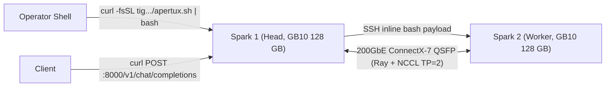

<p align="left">
  <picture>
    <source media="(prefers-color-scheme: dark)" srcset="assets/logo-dark.svg">
    <source media="(prefers-color-scheme: light)" srcset="assets/logo-light.svg">
    
  </picture>
</p>

Deploy Swiss-AI `Apertus-v1.5-70B` across two stacked NVIDIA DGX Sparks with a single `curl | bash` command and query it over an OpenAI-compatible HTTP endpoint.

## Primary Next Action

Run on **Spark 1** (with a 200GbE QSFP cable connected to Spark 2 and SSH access to `nvidia@spark2`):

```bash
curl -fsSL https://tig.eigenlab.ch/roland/apertux/raw/branch/main/apertux.sh \
  | bash -s -- --worker nvidia@spark2 --assign-fabric-ips
```

Once the built-in health and smoke check completes, query Apertus from any machine able to reach Spark 1:

```bash
curl -sS http://<spark1-ip>:8000/v1/chat/completions \
  -H "Content-Type: application/json" \
  -d '{
    "model": "swiss-ai/Apertus-v1.5-70B",
    "messages": [{"role": "user", "content": "Gruezi! Summarize the Swiss Federal Charter in two sentences."}],
    "max_tokens": 128
  }'
```

## Key Facts

1. **256 GB pooled unified memory (`TP=2`):** Shards `swiss-ai/Apertus-v1.5-70B` (`bfloat16`, ~145 GB weights) across both GB10 Grace Blackwell nodes with `--kv-cache-dtype fp8`, `--enable-prefix-caching`, and the full `262144` token context window.
2. **Strict 200GbE ConnectX-7 pinning:** Auto-detects active Mellanox/ConnectX-7 ports (`ibdev2netdev` / `enp1s0f*`) and pins Ray, Gloo, UCX, and NCCL traffic exclusively to the 200GbE link.
3. **Local-only governance:** Telemetry is disabled unconditionally; cached startups run strictly offline (`HF_HUB_OFFLINE=1`); first-time image or weight downloads pause for human confirmation on `/dev/tty` (or `--approve-download`).

## Overview



## Documentation

- Runbook (how-to): [docs/runbooks/deploy-two-sparks.md](docs/runbooks/deploy-two-sparks.md)
- Reference (flags, env vars, ports, memory math): [docs/reference/configuration.md](docs/reference/configuration.md)
- Roadmap: [docs/ROADMAP.md](docs/ROADMAP.md)
- Changelog: [CHANGELOG.md](CHANGELOG.md)

## References

- **Apertus (Swiss AI Initiative - ETH Zurich, EPFL, CSCS):** Open-weights multilingual and multimodal foundation models, documentation, and `APERTVS` visual identity - [apertus-ai.org](https://apertus-ai.org) and [huggingface.co/swiss-ai](https://huggingface.co/swiss-ai).
- **Oleg Lavrovsky:** Technical community stewardship, open sovereign AI outreach, and contributions across the Apertus documentation and runtime ecosystem at the EPFL AI Center / Swiss AI Initiative - [github.com/loleg](https://github.com/loleg) and [datalets.ch](https://datalets.ch).
- **NVIDIA DGX Spark Playbooks:** Dual-Spark 200GbE ConnectX-7 networking and distributed multi-node Ray + NCCL reference workflows - [build.nvidia.com/spark](https://build.nvidia.com/spark).
- **vLLM:** High-throughput tensor-parallel LLM serving engine and OpenAI-compatible HTTP server - [docs.vllm.ai](https://docs.vllm.ai).
