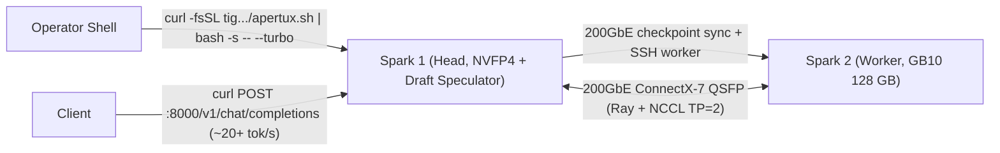

<p align="left">
  <picture>
    <source media="(prefers-color-scheme: dark)" srcset="assets/logo-dark.svg">
    <source media="(prefers-color-scheme: light)" srcset="assets/logo-light.svg">
    
  </picture>
</p>

Deploy Swiss-AI `Apertus-v1.5-70B` across two stacked NVIDIA DGX Sparks with a single `curl | bash` command, either in unquantized `bfloat16` or in `--turbo` mode (`NVFP4` + speculative decoding for ~20+ tok/s interactive generation).

## Primary Next Action

Run on **Spark 1** (`--turbo` enables 128 GB-safe local `NVFP4` quantization, 200GbE checkpoint sync to Spark 2, and `Apertus-v1.1-1.5B-Instruct` speculative decoding; omit `--turbo` for raw `bfloat16`):

```bash
curl -fsSL https://tig.eigenlab.ch/roland/apertux/raw/branch/apertux-turbo/apertux.sh \
  | bash -s -- --worker nvidia@spark2 --assign-fabric-ips --turbo
```

Query or benchmark throughput (`tok/s`) from any host able to reach Spark 1:

```bash
curl -sS http://<spark1-ip>:8000/v1/chat/completions \
  -H "Content-Type: application/json" \
  -d '{
    "model": "swiss-ai/Apertus-v1.5-70B",
    "messages": [{"role": "user", "content": "Gruezi! Summarize the Swiss Federal Charter in two sentences."}],
    "max_tokens": 128
  }'
```

## Key Facts

1. **Overcomes the 273 GB/s LPDDR5X bandwidth wall (`--turbo`):** Compresses `Apertus-v1.5-70B` from ~145 GB (`bfloat16`, ~3 tok/s) to ~38 GB (`NVFP4`) or ~70 GB (`FP8_DYNAMIC`) and pairs it with `Apertus-v1.1-1.5B-Instruct` draft speculation (`K=5`) or `ngram` lookup so GB10's 1 PFLOP FP4 compute verifies multiple tokens per memory read (~20+ tok/s).
2. **256 GB pooled unified memory (`TP=2` over 200GbE):** Auto-detects active ConnectX-7 ports (`ibdev2netdev` / `enp1s0f*`), pins Ray, Gloo, UCX, and NCCL strictly to the 200GbE link, and supports the full `262144` context window with `fp8` KV cache and prefix caching.
3. **Local-only governance:** Telemetry is disabled unconditionally; `NVFP4` calibration uses a built-in offline dataset (zero external dataset downloads); cached runs execute with `HF_HUB_OFFLINE=1`; cold caches require `/dev/tty` confirmation or `--approve-download`.

## Overview



## Documentation

- Runbook (how-to): [docs/runbooks/deploy-two-sparks.md](docs/runbooks/deploy-two-sparks.md)
- Reference (flags, quantization schemes, speculative modes, bandwidth math): [docs/reference/configuration.md](docs/reference/configuration.md)
- Roadmap: [docs/ROADMAP.md](docs/ROADMAP.md)
- Changelog: [CHANGELOG.md](CHANGELOG.md)

## References

- **Apertus (Swiss AI Initiative - ETH Zurich, EPFL, CSCS):** Open-weights multilingual and multimodal foundation models, documentation, and `APERTVS` visual identity - [apertus-ai.org](https://apertus-ai.org) and [huggingface.co/swiss-ai](https://huggingface.co/swiss-ai).
- **Oleg Lavrovsky:** Technical community stewardship, open sovereign AI outreach, and contributions across the Apertus documentation and runtime ecosystem at the EPFL AI Center / Swiss AI Initiative - [github.com/loleg](https://github.com/loleg) and [datalets.ch](https://datalets.ch).
- **NVIDIA DGX Spark Playbooks:** Dual-Spark 200GbE ConnectX-7 networking and distributed multi-node Ray + NCCL reference workflows - [build.nvidia.com/spark](https://build.nvidia.com/spark).
- **vLLM:** High-throughput tensor-parallel LLM serving engine and OpenAI-compatible HTTP server - [docs.vllm.ai](https://docs.vllm.ai).
